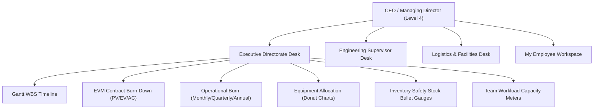
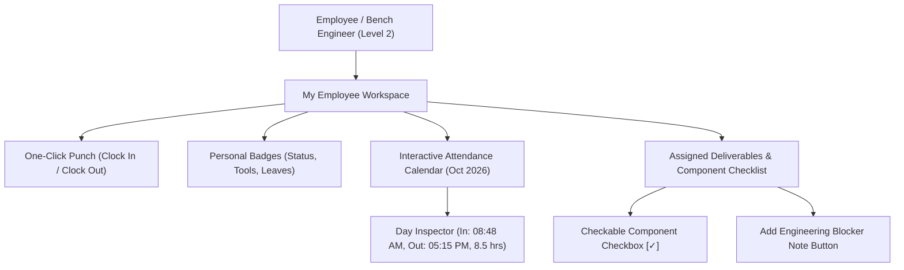

# Haalar Desk — Role-Based Feature Manual & Software Specification
**Defense & Aerospace Resource Management System (ERM)**  
*Engineered for Haalar Services — Humak Industrial Facility, Islamabad, Pakistan*  
*Standardized on ERPNext Architecture, Tabular DocTypes & Non-Technical Desk Ergonomics*

---

## 1. System Philosophy & Architecture Overview

**Haalar Desk** is an on-premise, defense-grade Employee Resource Management (ERM) system tailored for high-reliability engineering, embedded prototyping, and precision aerospace fabrication. 

### Core Architectural Pillars
1. **ERPNext Data Integrity**:
   - Built on strict tabular DocTypes (`tab_user`, `tab_employee`, `tab_attendance`, `tab_task`, `tab_task_component`, `tab_project`, `tab_asset`, `tab_utility_bill`, `tab_kitchen_expense`, `tab_item`).
   - Immutable Audit Trail & DocStatus State Machine:
     - `docstatus = 0`: **Draft** (Editable, work-in-progress)
     - `docstatus = 1`: **Submitted** (Locked, verified, non-repudiable audit state)
     - `docstatus = 2`: **Cancelled** (Voided with mandatory ledger reversal)
   - Predictable Naming Series: Auto-generated identifiers matching defense inventory rules (`HR-EMP-0001`, `TASK-2026-0001`, `COMP-2026-0001`, `ASSET-0001`, `UTIL-2026-0001`, `KIT-2026-0001`).
2. **Strict Multi-Tier Role Segregation**:
   - Zero client-side impersonation or mock role toggling.
   - All access tokens are signed JSON Web Tokens (JWT) verified at the API gateway.
   - **Zero Knowledge Confidentiality**: Employees can never query, infer, or view company financial burn, utility bills, other personnel salaries, or executive balance sheets. Sensitive fields are stripped at the database query level.
3. **Non-Technical Desk Ergonomics**:
   - Designed for shop-floor technicians, senior machinists, and procurement clerks who are comfortable with physical ledgers and Microsoft Excel.
   - High-contrast visual cards, color-coded status badges, single-click punch actions, and self-calculating checkable component milestones replace complicated nested menus.

---

## 2. Role 1: Chief Executive Officer (CEO / Managing Director)

### Profile & Security Credentials
- **Clearance Level**: Level 4 (Top Secret / Executive Directorate)
- **Default Username**: `ceo` (or `ceo@haalar.com`)
- **Primary Operational Mandate**: Complete operational sovereignty, financial burn monitoring, solvency margin tracking, project delivery oversight, and capital asset allocation.

### 2.1 Workspace Access
The CEO has access to **all four workspaces** in the system:
1. **Executive Directorate Desk**: Executive analytics, EVM, financial balance sheets, and burn-down.
2. **Engineering Supervisor Desk**: Cross-project milestone Gantt chart, engineer task allocation, and team shift rosters.
3. **Logistics & Facilities**: Kitchen expenses, utility invoices, and component stock buffers.
4. **My Workspace**: Personal attendance logging and custodian equipment list.

### 2.2 Visualizations & Analytical Telemetry

#### A. Interactive Defense Engineering Gantt Timeline (WBS)
- **Temporal Scale**: October – November 2026 week-by-week visual calendar with real-time day marker (`OCT W4 (NOW)`).
- **Collapsible Project Phases**: Grouped by classified contracts (`PRJ-2026-0001: Radar DSP Core`, `PRJ-2026-0002: Telemetry ECU`).
- **Milestone Diamond Indicators (◆)**: Highlights contract milestones such as *Preliminary Design Review (PDR) Sign-Off*, *Critical Design Review (CDR) & Gerber Release*, and *Mil-STD-810H Compliance*.
- **Dynamic Component Fill**: The Gantt bar length spans the schedule, while the inner colored fill reflects physical component checklist completions (`completed / total`).
- **One-Click Project Filter**: Filter view by `All Projects`, `Radar DSP`, or `Telemetry ECU`.

#### B. Earned Value Management (EVM) Contract Cost-Efficiency
- **Multi-Line Triple Curve**:
  - **Planned Value ($PV$)**: Contractually budgeted work scheduled across project lifecycle.
  - **Earned Value ($EV$)**: Realized physical engineering milestone delivery.
  - **Actual Cost ($AC$)**: Actual monetary burn (materials, labor, testing, overhead).
- **Efficiency Indices Badges**:
  - **Cost Performance Index ($CPI = EV / AC$)**: Live value $1.08$ (indicates under-budget delivery, positive profit margin).
  - **Schedule Performance Index ($SPI = EV / PV$)**: Live value $0.99$ (indicates on-schedule performance).
  - **Cost Variance**: Shows net PKR saved against contract ceiling ($+\text{Rs. 1,025,000}$ on Radar DSP; $+\text{Rs. 520,000}$ on Telemetry ECU).

#### C. Operational Expenditure & Facilities Burn (Multi-Line Chart)
- **Period Toggles**: Switch between **Monthly (Jan–Oct 2026)**, **Quarterly (Q1–Q4)**, and **Annual (2024–2026)** views.
- **Trace Breakdown**:
  - Total Monthly Burn (Purple bold curve: $\text{Rs. 649,500}$)
  - Utility Invoices (Blue: IESCO electricity, SNGPL gas, PTCL dedicated fiber)
  - Lab Consumables & Operations (Emerald: solder alloy, flux, diesel fuel)
  - Canteen & Kitchen (Amber: daily tea, milk, mineral water)
- **Executive Solvency Strip**: Displays **Total Budgets Allocated** ($\text{Rs. 28,300,000}$), **Expenditures Realized** ($\text{Rs. 6,650,000}$), and **Remaining Margin Headroom** ($\text{Rs. 21,650,000}$).

#### D. Equipment Usage & Capital Allocation (Donut & Pie Charts)
- **Status View**: Visualizes asset deployment (In-Use: $50\%$, Available: $33\%$, Under Maintenance: $17\%$).
- **Category Capital View**: Breakdown by asset class (Oscilloscopes $\text{Rs. 9.25M}$, RF Test Gear $\text{Rs. 8.2M}$, SMD Assembly $\text{Rs. 2.8M}$, CNC Machining $\text{Rs. 4.5M}$).
- Interactive tooltip showing total equipment units and capital invested in PKR.

#### E. Team Workload Capacity Allocation Meters
- **No-Heatmap Multi-Project Stacked Meter**: Replaces ambiguous heatmaps with stacked capacity bars per engineer (`Usman`, `Zainab`, `Bilal`).
- Shows project percentage split, active bench locations (`RF Lab Bench A`, `Embedded Hardware Bay`), and remaining capacity headroom ($15\%\text{--}25\%$).

#### F. Aerospace Component Inventory Safety Stock Bullet Gauges
- Horizontal bullet gauge for critical long-lead parts (*Xilinx Artix-7 FPGA, STM32 MCU, Glenair MIL-DTL Connectors, Yageo Resistors*).
- Displays color-coded target bands (Red = Critical Stockout Risk, Amber = Reorder Lead-Time Zone, Green = Optimal Buffer).
- Displays actual stock indicator pin, lead-time in weeks, and unit rate in PKR.

### 2.3 Master Registers & Data Access
- **Employee Directory (`tab_employee`)**: Full, unrestricted access to all personnel profiles, CNIC numbers, mobile numbers, and complete executive payroll salaries ($\text{Rs. 450,000}$, $\text{Rs. 280,000}$, etc.).
- **Classified Projects (`tab_project`)**: Create, inspect, edit budget allocations, and review client classification codes.
- **Tasks Register (`tab_task`)**: Ability to create tasks, assign them to leads, define deliverables, and inspect blocker notes.
- **Utility Invoices (`tab_utility_bill`)**: Access to all municipal electricity, gas, internet, and generator fuel ledgers.
- **Kitchen & Canteen (`tab_kitchen_expense`)**: Review daily refreshment receipts, store vendors, and petty cash logs.
- **Equipment & Assets (`tab_asset`)**: Access to all high-value machinery, calibration dates, and repair work orders.

---

## 3. Role 2: Engineering Supervisor (Hardware & RF Lead)

### Profile & Security Credentials
- **Clearance Level**: Level 3 (Secret / Engineering Directorate)
- **Default Username**: `usman` (or `usman@haalar.com`)
- **Primary Operational Mandate**: Project execution, Work Breakdown Structure (WBS) management, deliverable task delegation, team workload balancing, and shift roster verification.

### 3.1 Workspace Access
1. **Engineering Supervisor Desk**: Primary operational hub.
2. **My Workspace**: Personal attendance, custody bench gear, and personal tasks.

### 3.2 Visualizations & Analytical Telemetry
- **Gantt Timeline Chart**: Cross-project view of all phases and nested tasks. Full authority to launch the **"+ Start Task"** modal to create new tasks, select projects, assign engineers, set start/due dates, and define initial component deliverables.
- **Team Workload Capacity Allocation Meters**: Real-time visibility into whether bench engineers (e.g., Zainab or shop floor technicians) have available bandwidth headroom or are bottlenecked by urgent tasks.
- **Attendance & Shift Roster Strip**: Real-time counter of present engineers ($3/4$), lab tools checked out, and pending leave requests.

### 3.3 Master Registers & Data Permissions
- **Tasks Register (`tab_task`)**: Full read/write access. Can create new tasks, reassign personnel, update milestone deadlines, and inspect engineering blocker remarks.
- **Classified Projects (`tab_project`)**: Read-only access to technical project specifications, customer mask codes, and engineering deadlines. (Financial cost variances and company burn curves are hidden).
- **Attendance Log (`tab_attendance`)**: Full departmental roster access to verify check-in/check-out timestamps across engineering staff.
- **Equipment & Tools (`tab_asset`)**: Full read/write access to assign bench gear, schedule calibration, and log repair work-orders (`tab_asset_repair`).
- **Confidentiality Restrictions**:
  - **403 Forbidden** on Utility Bills (`tab_utility_bill`), Kitchen Expenses (`tab_kitchen_expense`), and Executive Expense Claims (`tab_expense_claim`).
  - Cannot access company-wide salary payroll in `tab_employee`.

---

## 4. Role 3: Logistics & Facilities Administrator

### Profile & Security Credentials
- **Clearance Level**: Level 2 (Confidential / Logistics & Supply Chain)
- **Default Username**: `bilal` (or `bilal@haalar.com`)
- **Primary Operational Mandate**: Store inventory management, inwards Goods Received Notes (GRN), lab equipment calibration logistics, utility billing verification, and canteen/kitchen expenditure tracking.

### 4.1 Workspace Access
1. **Logistics, Warehouse & Facility Operations**: Inventory, facilities, and expense management.
2. **My Workspace**: Personal attendance, custody equipment, and assigned supply chain deliverables.

### 4.2 Visualizations & Analytical Telemetry
- **Inventory Safety Stock & Lead-Time Bullet Gauges**: Primary operational tool to monitor buffer stock of microchips, passive components, and aerospace connectors.
  - Alerts on parts entering the Reorder Window (e.g., Artix-7 FPGAs with 12-week international transit times).
  - Flags critical stockout emergencies (e.g., Glenair connectors below minimum buffer).
- **Logistics Number Cards**: Quick metrics tracking **Kitchen & Canteen Spend** ($\text{Rs. 11,000}$), **Utility Invoices** ($\text{Rs. 455,500}$), and **Component Stock** ($3\text{+} \text{ Parts}$).

### 4.3 Master Registers & Data Permissions
- **Component Stock Register (`tab_item`)**: Full read/write access. Manage bin locations, current warehouse stock, standard unit rates, and reorder levels.
- **Equipment & Tools (`tab_asset`)**: Access to calibration expiry dates, serial numbers, vendor OEM maintenance contacts, and transit packaging for metrology audits.
- **Canteen / Kitchen Expense Register (`tab_kitchen_expense`)**: Full read/write access. Ability to record daily groceries, milk, sugar, mineral water dispensaries, and vendor stores (`Humak Wholesale Mart`). Supports `Draft -> Submit` locking.
- **Utility Invoices Register (`tab_utility_bill`)**: Full read/write access. Log IESCO, SNGPL, PTCL, and backup generator diesel fuel bills with consumer numbers, due dates, and paid receipts.
- **Confidentiality Restrictions**:
  - Cannot access classified project architecture documents, client defense codes, or executive EVM burn-down charts.
  - Cannot access executive employee salary payroll.

---

## 5. Role 4: Employee / Bench Engineer (Firmware, Hardware, Assembly)

### Profile & Security Credentials
- **Clearance Level**: Level 2 (Engineering Technical Clearance)
- **Default Username**: `zainab` (or `zainab@haalar.com`)
- **Primary Operational Mandate**: Execution of technical deliverables, firmware coding, hardware bring-up, bench testing, component checklist completion, and daily presence logging.

### 5.1 Workspace Access
- **Strictly Limited to 1 Workspace**: **"My Workspace"**.
- Executive Desk, Supervisor Desk, and Logistics Operations Desk are completely excluded from the navigation sidebar and blocked at the API gateway (`403 Forbidden`).

### 5.2 Visualizations & Interactive Tools

#### A. Interactive Attendance Calendar (October 2026)
- **Full Month Visual 7-Day Grid**:
  - **Green Blocks (`bg-emerald-50`)**: Days Present with punch-in timestamps (e.g., `08:48 AM`).
  - **Red Blocks (`bg-rose-50`)**: Unexcused Absence flagged (Day 9).
  - **Amber Blocks (`bg-amber-50`)**: Approved Medical Leave / Half Day (Day 15).
  - **Gray Blocks (`bg-gray-50`)**: Weekends and future scheduled days.
- **Summary Badges**: Displays verified monthly counts (`13 Days Present`, `1 Day Absent`, `1 Approved Leave`).
- **Interactive Day Inspector Card**: Clicking any day card displays:
  - Exact Date & Day name
  - Status indicator
  - Check-In Time, Check-Out Time, and Total Working Hours
  - Supervisor notes (e.g., *"Half-Day Medical Leave (Approved)"* or *"Unexcused Absence (Flagged)"*).

#### B. Assigned Deliverables & Physical Component Checklists
- **Mathematical Progress Tracking**:
  - Replaces arbitrary sliders with tangible engineering deliverables.
  - Displays assigned tasks (e.g., `TASK-2026-0002 Telemetry ECU CAN-Bus Driver & Bootloader`).
  - For each deliverable, displays real physical components:
    - `[✓] CAN-Bus physical layer hardware transceiver loopback test`
    - `[✓] Dual-bank flash memory partition & bootloader state machine`
    - `[✓] CRC32 image integrity check & hardware watchdog timeout`
    - `[ ] Firmware over-the-air (FOTA) verification bench endurance test`
  - **One-Click Checkbox Action**: Checking any box toggles completion state in the database, automatically recalculating the task progress percentage ($75\%$).
- **Inline Engineering Blocker / Technical Note Input**:
  - On incomplete components, an **"+ Add Note / Blocker"** button opens an inline text box.
  - The employee can log immediate lab blockers (e.g., *“Investigating CAN frame timeout on noisy generator power bench”*).
  - Notes immediately appear with an amber alert tag, alerting the supervisor.

#### C. Personal Equipment in Custody
- Displays high-value instruments currently checked out to the employee's custody (e.g., `ASSET-0005 Keysight Infiniium 8-Channel Protocol Analyzer`, Serial: `SN-KEY-INF-005`, Location: `Embedded Hardware Bay`).

### 5.3 Master Registers & Strict Confidentiality Rules
- **Attendance Log (`tab_attendance`)**: Employees can only view their own personal punches. Other staff records are filtered out.
- **Equipment & Tools (`tab_asset`)**: Read-only view of bench gear to verify custody and location.
- **Tasks Register (`tab_task`)**: View only deliverables assigned directly to their employee profile.
- **Strict Data Masking on Staff Directory (`tab_employee`)**:
  - If an employee queries `tab_employee`, sensitive columns are masked at the API gateway:
    - `salary_pkr` $\rightarrow$ `undefined`
    - `cnic` $\rightarrow$ `undefined`
- **Total Ledger Blocking**:
  - Any request to `/api/doctype/tab_utility_bill`, `/api/doctype/tab_kitchen_expense`, or `/api/doctype/tab_expense_claim` results in:
    `403 Forbidden: Confidentiality restriction: Access denied.`

---

## 6. Comprehensive Role & Feature Matrix

| Feature / Module | CEO | Supervisor | Logistics Admin | Employee |
| :--- | :---: | :---: | :---: | :---: |
| **Login Screen & JWT Auth** | Level 4 | Level 3 | Level 2 | Level 2 |
| **Executive Directorate Desk** | Full Access | Hidden | Hidden | Hidden |
| **Engineering Supervisor Desk** | Full Access | Full Access | Hidden | Hidden |
| **Logistics & Facilities Desk** | Full Access | Hidden | Full Access | Hidden |
| **My Employee Workspace** | Full Access | Full Access | Full Access | **Only View** |
| **Interactive Gantt Timeline (WBS)** | Full Access | Full Access | Hidden | Hidden |
| **Earned Value Management (EVM)** | Full Access | Hidden | Hidden | Hidden |
| **Operational Burn Line Chart** | Monthly/Qtr/Yr | Hidden | Hidden | Hidden |
| **Solvency Balance Sheet Strip** | Full View | Hidden | Hidden | Hidden |
| **Equipment Donut / Pie Charts** | Status & Value | Hidden | Hidden | Hidden |
| **Team Workload Capacity Meters** | Full View | Full View | Hidden | Hidden |
| **Inventory Stock Bullet Gauges** | Full View | Hidden | Full View | Hidden |
| **Attendance Calendar (Green/Red)** | Personal | Personal | Personal | **Interactive Grid** |
| **Component Checklist Checkboxes** | View | Create/Assign | View | **Check / Uncheck** |
| **Component Blocker Notes** | Read Notes | Read Notes | Read Notes | **Record Notes** |
| **Start Task Modal** | Yes | Yes | No | No |
| **Clock In / Clock Out Action** | Yes | Yes | Yes | Yes |
| **Employee Salaries & CNICs** | **Unmasked** | Hidden | Hidden | **Masked (Undefined)** |
| **Utility Invoices (`tab_utility_bill`)** | Full Access | **403 Forbidden** | Full Access | **403 Forbidden** |
| **Kitchen Expenses (`tab_kitchen`)** | Full Access | **403 Forbidden** | Full Access | **403 Forbidden** |
| **Classified Projects (`tab_project`)** | Full Access | Technical Only | Hidden | Hidden |
| **DocStatus Submit Lifecycle** | Yes | Yes | Yes | No |

---

## 7. Interactive Verification & User Walkthrough

To demonstrate this system to stakeholders or run end-to-end user acceptance testing:

### Test Case A: Employee Daily Routine (Zainab)
1. Navigate to **`http://localhost:3000`**.
2. Click the preset credential pill **"Employee (Zainab)"** and click **Sign In**.
3. **Verify Confidentiality**: Note that only **"My Workspace"** exists in the sidebar. No burn metrics or executive buttons are visible.
4. **Inspect Attendance**: Review the October 2026 calendar. Click **Day 9 (Red block)** to view the flagged unexcused absence, and **Day 15 (Amber block)** to view the approved medical leave.
5. **Update Engineering Deliverable**:
   - Scroll to **"My Assigned Deliverables & Phase Components"**.
   - Locate `TASK-2026-0002 Telemetry ECU`.
   - Click the checkbox next to `Firmware over-the-air (FOTA) verification bench endurance test`.
   - Observe that the task progress immediately recalculates to **$100\%$ Completed**.
   - Click **"+ Add Note / Blocker"**, type a technical note, and click **Save**.
6. Log out.

### Test Case B: Executive Oversight & Gantt Audit (CEO Taha)
1. Sign in using the preset credential pill **"CEO (Taha)"**.
2. **Verify Full Sovereignty**: Notice all four workspaces are available in the sidebar.
3. **Inspect Interactive Gantt Chart**:
   - Observe that `TASK-2026-0002` under `Phase 2` shows updated component fill reflecting Zainab's checkbox action.
   - Click the project filter pills (`All Projects`, `Radar DSP`, `Telemetry ECU`) to filter timelines.
4. **Review Team Workload Capacity Meters**:
   - Inspect the stacked allocation bars for Usman ($85\%$), Zainab ($75\%$), and Bilal ($90\%$) with bench locations.
5. **Inspect Inventory Safety Stock Bullet Gauges**:
   - Review the target ranges (Red/Amber/Green) and current stock markers for FPGAs, MCUs, and Glenair connectors.
6. **Inspect Contract Solvency (EVM Curve)**:
   - Review Planned Value vs. Earned Value vs. Actual Cost curves with verified $CPI = 1.08$ and $SPI = 0.99$.
7. **Toggle Operational Expenses**:
   - Switch between **Monthly**, **Quarterly**, and **Annual** views on the facilities burn chart.
8. **Inspect Full Payroll**:
   - Open **"Employee Directory"** under Master Registers. Observe that full unmasked salaries and CNICs are visible only to the CEO.
